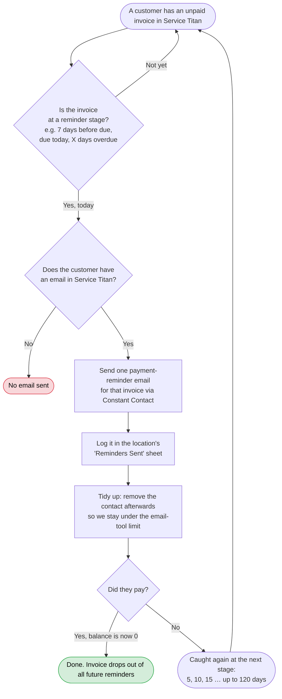
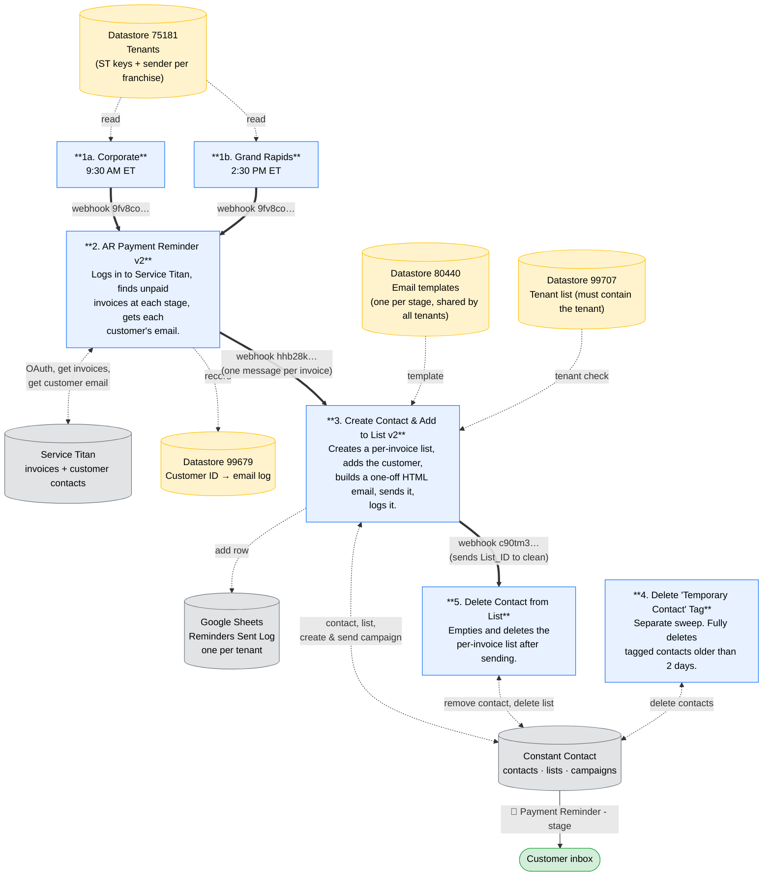
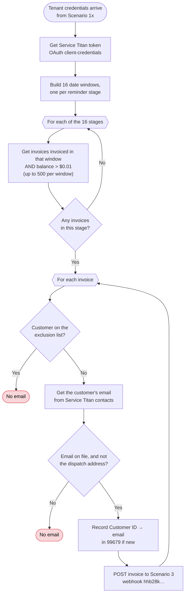
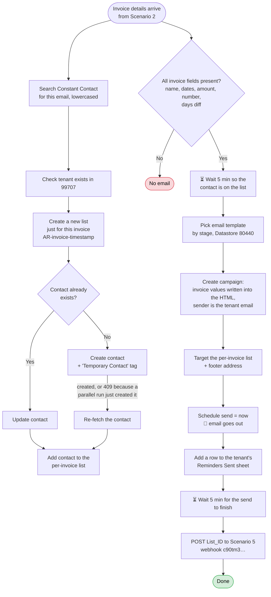

# AR Automation

Documentation for the **Accounts Receivable (AR) automation**: a Make.com pipeline that pulls
unpaid invoices from Service Titan every day and emails customers staged payment reminders through
Constant Contact.

> This README is the single source of truth for the system: what it does, how it works end to end,
> how to change it safely, and what is still open. Last updated: November 2026.

---

## Table of contents

1. [What this project does](#1-what-this-project-does)
2. [Business view](#2-business-view)
3. [Architecture: the live scenarios](#3-architecture-the-live-scenarios)
4. [Scenario-by-scenario reference](#4-scenario-by-scenario-reference)
5. [Datastores, credentials and configuration](#5-datastores-credentials-and-configuration)
6. [Sent-reminder logs](#6-sent-reminder-logs)
7. [How to make common changes](#7-how-to-make-common-changes)
8. [Concerns and open items](#8-concerns-and-open-items)
9. [Change history](#9-change-history)

---

## 1. What this project does

The AR automation handles accounts-receivable collections for Junk Shot / Accelerated Waste
Solutions (ASF). Every day, for each enabled franchise (tenant), it pulls unpaid invoices from
**Service Titan**, matches them to reminder stages (7 days before due, due today, then 5 to 120 days
overdue, 16 stages in total), and emails the customer a payment reminder through **Constant
Contact** (CC).

It exists to solve three problems: the time the client-success team spent on manual follow-ups, slow
payment collection, and a Constant Contact limitation. CC's API can only create campaigns from raw
HTML, so the system builds a fresh one-off HTML campaign for every single reminder, with that
invoice's details written directly into the email.

**Live tenants:** Corporate (HQ-01) and Grand Rapids. Solano Napa is prepared but not launched.

---

## 2. Business view

This section focuses on the outcome, not the wiring. The implementation details are documented below.

In short: every day the system finds unpaid invoices that have reached a reminder milestone, emails
each customer once per invoice per milestone, logs every send, and stops automatically when they pay.
A customer with several overdue invoices gets one separate email per invoice.

---

## 3. Architecture: the live scenarios

| Trigger | Scenario | Status |
|---------|----------|--------|
| ⏰ Daily 9:30 AM ET | **1a. Multi-tenant Triggers v2 - Corporate (HQ-01)** | ON |
| ⏰ Daily 2:30 PM ET | **1b. Multi-tenant Triggers v2 - Grand Rapids** | ON |
| ⏰ (not scheduled) | **1c. Multi-tenant Triggers v2 - Solano Napa** | Prepared, OFF |
| ⚡ Webhook | **2. AR Payment Reminder v2** | ON |
| ⚡ Webhook | **3. Create Contact and Add to List in Constant Contact v2** | ON |
| ⏰ Scheduled | **4. Delete "Temporary Contact" Tag** | ON |
| ⚡ Webhook | **5. Delete Contact from List** | ON |

The whole system is a **relay race**: each scenario does one job and hands a payload to the next
through a Make webhook. There is **one trigger scenario per tenant**, so each location runs on its
own schedule; all of them feed the same Scenario 2. Scenarios 4 and 5 are the two cleanup jobs that
keep Constant Contact under its contact cap.

Thick arrows (`==>`) are the live webhook chain, in order. Dotted arrows are reads and writes to
external systems and datastores.

---

## 4. Scenario-by-scenario reference

| # | Scenario | Trigger | Role | Key external calls |
|---|----------|---------|------|--------------------|
| 1a / 1b / 1c | Multi-tenant Triggers v2 (one per tenant) | Schedule | Send one tenant's credentials into the pipeline | Make webhook `9fv8co…` |
| 2 | AR Payment Reminder v2 | Webhook 2308425 | Pull and stage invoices, find customer email, fan out per invoice | ST auth, `accounting/v2/.../invoices`, `crm/v2/.../customers/{id}/contacts`; Make webhook `hhb28k…` |
| 3 | Create Contact & Add to List v2 | Webhook 2269064 | Contact upsert, per-invoice list, build and send a one-off HTML campaign, log the send | CC `/v3/contacts`, `/v3/contact_lists`, `/v3/emails`, `/v3/emails/activities/.../schedules`; Google Sheets; Make webhook `c90tm3…` |
| 4 | Delete "Temporary Contact" Tag | Schedule | Purge tagged contacts older than 2 days | CC `/v3/contacts?tags=6ee593ba…`, DELETE `/v3/contacts/{id}` |
| 5 | Delete Contact from List | Webhook 2313509 | Empty and delete the per-invoice list after the send | CC `listContacts`, `deleteContactsFromLists`, DELETE `/v3/contact_lists/{id}` |

### Scenarios 1a / 1b / 1c: Multi-tenant Triggers v2

Each one reads every row of **Datastore 75181** and lets exactly one tenant through its filter,
then POSTs that tenant's credentials and details to Scenario 2's webhook.

| Scenario | Tenant ID | Schedule |
|----------|-----------|----------|
| 1a. Corporate (HQ-01) | `2521477657` | Daily 9:30 AM ET |
| 1b. Grand Rapids | `4271888533` | Daily 2:30 PM ET |
| 1c. Solano Napa | `3545382800` | Not scheduled (OFF) |

Credentials travel inside the webhook payload (not via a Make connection), which is what lets
Scenario 2 serve any tenant. **Only one trigger scenario may exist per tenant**, otherwise that
tenant's customers are emailed twice.

### Scenario 2: AR Payment Reminder v2 (the brain)

The key idea: instead of asking "what's due in 7 days?" it asks "what was **invoiced** N days ago?",
because with 30-day terms an invoice's age tells you its stage.

The 16 windows: invoiced 22 to 23 days ago is *7 days before due*; 29 to 30 days is *due today*; then
5-day steps from *5 days overdue* to *30*, then *45, 60, 70, 80, 90, 100, 110, 120*. Days past due
are calculated per invoice from its own due date. If Service Titan returns `dueDate == invoiceDate`,
the flow assumes due = invoice date + 30 days.

**Datastore 99679 is a log, not a duplicate filter.** Both branches send: an existing customer is
sent straight away; a new one is recorded first, then sent. Duplicates are avoided by the date
windows instead: an invoice falls into a given stage's window on only one day.

**Payload contract from 2 to 3** (don't rename these fields; Scenario 3's mappers depend on them):
`name, email, duedate, invoicedate, number, amount_due, customer portal, tenantNumber,
tenantAddress, tenantEmail, tenantName, tenant_ID, Days Diff, Address Line 1, City, Postal Code,
State Code`.

### Scenario 3: Create Contact & Add to List (the mouth)

Constant Contact's API can't send a normal templated email to one person, so this scenario builds a
brand-new one-recipient HTML campaign for each invoice, sends it, logs it, then asks Scenario 5 to
clean up.

Design points that matter (each one fixes a real incident):

- **One list per invoice.** Each campaign targets a list created for that invoice alone, so it can
  only ever reach that one customer. A shared per-stage list previously sent customers each other's
  reminders.
- **Invoice values are written straight into the HTML** (`[[custom.st_*]]` placeholders replaced in
  Make), not read from CC contact fields, which each new invoice overwrote.
- **Blank-field gate.** The campaign is only created if the invoice fields are all present.
- **Race recovery.** A customer with several invoices on the same day triggers parallel runs; if a
  create fails with 409 because a parallel run just created the contact, the run resumes and
  re-fetches the contact instead of stopping.
- **Sender** (`from` and `reply-to`) is the tenant's `tenant_email` from Datastore 75181, so each
  location sends from its own address and receives its own replies.
- **Subject:** `Payment Reminder - <stage name>`. **Campaign name:**
  `Payment Reminder- <stage> - Inv <number> - <date time> (<tenant name>)`.

The `Temporary Contact` tag applied at creation is exactly what Scenario 4 hunts for. The two
scenarios are linked by that tag, not by a webhook.

### Scenarios 5 and 4: the cleanup crew

- **Scenario 5 (Delete Contact from List)** receives a `List_ID`, lists its contacts, removes them,
  then deletes the per-invoice list itself. It processes runs in order to avoid CC rate limits
  (429s). This is the most important business constraint in the project: the CC plan caps contacts
  at roughly 25,000 to 30,000 across about 30,000 customers, so contacts can only live in CC briefly.
- **Scenario 4 (Delete "Temporary Contact" Tag)** is the safety net. This sweep fully deletes any
  contact tagged `Temporary Contact` that is older than 2 days. If either cleanup stops running, the
  contact count drifts toward the cap and sends eventually fail.

---

## 5. Datastores, credentials and configuration

| Datastore | ID | Used by | Contents |
|-----------|----|---------|----------|
| Tenants | 75181 | 1a/1b/1c (plus Soft Booking) | Per tenant: `tenant_id`, `tenant_name`, ST `client_ID` / `client_secret` / `app_key`, portal URL, `tenant_email` (sender), phone, address, footer fields `Address Line 1` / `City` / `Postal Code` / `State Code` |
| Constant Contact Emails (AR Payment) | 99679 | 2 | Log of Customer ID → email for customers who have been sent a reminder |
| Constant Contact, Overdue Days and Email Template | 80440 | 3 | 16 rows, one per stage, keyed by `Day Difference`: name, email HTML, pre-header. **Shared by all tenants** |
| Constant Contact, Multiple Tenant Lists | 99707 | 3 | One row per enabled tenant. Scenario 3 **stops** if the tenant isn't here |

**Credentials and connections**
- **Service Titan:** OAuth client-credentials *per tenant*, stored in Datastore 75181 (not in Make
  connections). The `St-App-Key` header is required on every API call.
- **Constant Contact:** Make connection **7441904**, authenticated as **info@acceleratedwaste.com**.
- **Google Sheets:** Make Google connection used by the sent-reminder log module in Scenario 3.
- **Make webhooks (us2):** `9fv8co…` to Scenario 2 · `hhb28k…` to Scenario 3 · `c90tm3…` to
  Scenario 5.

**Hardcoded values that may need to change**
- Tenant filter in each trigger scenario (1a/1b/1c).
- The customer exclusion list in Scenario 2 (filter on the "Get Customers Contact" module) and the
  excluded email `dispatch@acceleratedwaste.com`.
- CC custom-field UUIDs and the tag `6ee593ba…` in Scenario 3.
- From-name "JUNK SHOT - Junk Removal & Valet Trash" in Scenario 3.
- The tenant → sheet choice in the Scenario 3 log module (see section 6).
- Sleeps in Scenario 3: 10 s after contact create/update, 300 s before building the campaign,
  300 s after sending before cleanup.

---

## 6. Sent-reminder logs

Constant Contact sends reminders from its own servers, so they never appear in anyone's Sent folder,
and CC has no CC/BCC option on campaigns. Instead, Scenario 3 logs every reminder it sends to a
Google Sheet, one sheet per location:

- **AR Reminders Sent Log - Corporate**
- **AR Reminders Sent Log - Grand Rapids**

Columns: Sent At (ET) · Location · Tenant ID · Customer Name · Customer Email · Invoice Number ·
Invoice Date · Due Date · Amount Due · Days Past Due · Reminder Stage.

The log step sits right after the send, so a row is only written once the email has actually been
sent. It picks the sheet from the tenant ID (Grand Rapids' ID → Grand Rapids sheet, anything else →
Corporate sheet), and has an **Ignore** error handler so a Sheets failure can never block the
cleanup in Scenario 5. Cost: 1 Make credit per reminder.

To check whether a reminder went out, search the invoice number in the location's sheet, or search
it under Campaigns in Constant Contact.

---

## 7. How to make common changes

### Change the email design or wording

The emails customers receive are built from **Datastore 80440**, not from anything in Constant
Contact. Editing the old "Payment reminder - N days past due (HQ-01)" Automation Paths in CC changes
nothing customers see.

- Edit the `Email HTML` field of each stage's row (16 rows). All tenants share these templates.
- Keep the placeholders exactly as they are: `[[custom.st_full_name]]`, `[[custom.st_invoice_date]]`,
  `[[custom.st_due_date]]`, `[[custom.st_invoice_number]]`, `[[custom.st_amount_due]]`,
  `[[custom.st_customer_portal_link]]`, `[[custom.st_phone_number]]`, `[[custom.st_tenant_email]]`,
  `[[custom.st_address]]`, `[[trackingImage]]`. Do **not** paste HTML from a CC automation: its
  `[[custom.st-_x OR ""]]` tags are a different format and won't be filled in.
- The stored HTML has pre-escaped quotes (`\"`) because Scenario 3 embeds it in a JSON string. Keep
  that escaping.
- Images must be hosted URLs (e.g. uploaded to CC's library), not attachments.
- **Test safely:** add a temporary row with `Day Difference = 999`, send a test to Scenario 3's
  webhook with `"Days Diff": 999` and your own email address, check the email, then delete the row.
  The per-invoice list means only that address can receive it.
- Rows can be edited in the Make UI, or via Make's API (`/api/v2/data-stores/80440/data`, PATCH a
  row with only `Email HTML` to leave the other fields untouched). Make's API rejects Python's
  default User-Agent with a 403; send a curl-style User-Agent.

### Add a new tenant (location)

1. **Datastore 75181:** the tenant's row must have ST credentials, `tenant_email` (sender), phone,
   address, portal, and the 4 footer fields `Address Line 1`, `City`, `Postal Code`, `State Code`.
2. **Datastore 99707:** add a row for the tenant ID, or Scenario 3 stops.
3. **Constant Contact:** the tenant's sender email must be a verified sender.
4. **Trigger scenario:** copy 1a, change the tenant filter to the new tenant ID, set its schedule.
5. **Log sheet:** create the tenant's sheet and add it to the sheet choice in Scenario 3's log
   module, otherwise its rows go to the Corporate sheet.
6. **Test:** a test send through Scenario 3 to your own email with the tenant's details, then watch
   the first real run.

### Test anything in Scenario 3

POST a payload with the field names from the payload contract above to Scenario 3's webhook, using
your own email address. Use a unique invoice number per test (list names include it). Clean up
afterwards: the test contact, any `AR-<test number>-*` lists, the test campaigns, and the log row.

**Don't retry runs from Incomplete Executions after changing a scenario:** a retried incomplete
execution runs the old version. "Replay run" from History does use the latest version.

---

## 8. Concerns and open items

1. **Make credit usage.** Usage averages about 1,600 credits a day, more than the 40,000 a month the
   Pro plan includes. Credits ran out on Oct 18, 2026 and every scenario paused until extra credits
   were bought. Needs a bigger plan or lower usage.
2. **Pagination ceiling.** Scenario 2 fetches up to 500 invoices per stage window with no page loop.
   Current volumes are well below that, but anything over 500 in one window would be dropped silently.
3. **30-day-terms assumption.** Stages filter on invoice *creation* date. Invoices with
   non-standard terms get mis-staged (wrong "days overdue" wording).
4. **Blank-field gate.** In Scenario 3's gate, the invoice-number rule has a trailing space in its
   field reference, so that one rule always passes. The other rules work.
5. **Old CC automations still active.** The 16 "Payment reminder - N days past due (HQ-01)"
   Automation Paths in Constant Contact are from before the rebuild. Nothing triggers them (last send
   Sep 9, 2026), but they would send an old-style email if anyone adds a contact to an
   "AR - N days past due" list by hand. Pausing them is recommended.
6. **Log sheets live in a personal Google account.** The sent-reminder sheets and the Google
   connection belong to a personal account. Move them to a company account before relying on them
   long term.
7. **Templates shared by all tenants.** A template change applies to every location at once. A
   tenant-specific design would need separate template rows and a tenant check in Scenario 3.

---

## 9. Change history

| Date | Change |
|------|--------|
| Sep 2026 | **Per-tenant triggers.** Single trigger split into 1a (Corporate, 9:30 AM ET) and 1b (Grand Rapids, 2:30 PM ET). |
| Sep 2026 | **Wrong / blank email fixes.** Invoice values written into the HTML per invoice; days-past-due calculated per invoice; subject and campaign names made unique; blank-field gate added. |
| Sep 2026 | **Per-invoice lists.** Each campaign targets its own list (fixes customers receiving each other's reminders). Scenario 5 now deletes the list after emptying it. |
| Sep 2026 | **Pagination** raised from 20 to 500 invoices per stage window. |
| Sep 2026 | **Race-condition fix.** Contact-create conflicts (409) from parallel runs now recover instead of stopping the reminder. Emails are lowercased and trimmed before lookup. |
| Sep 2026 | **Rate limits.** Scenario 5 processes runs in order, with error handling for CC 429s. |
| Oct 2026 | **New email header.** Updated Junk Shot logo only (RealPage logo removed), illustration beside the heading, all 16 templates. |
| Oct 2026 | **Sent-reminder logs.** Every send logged to a Google Sheet per location. |
| Oct 2026 | **Solano Napa** trigger scenario prepared (not launched). |
